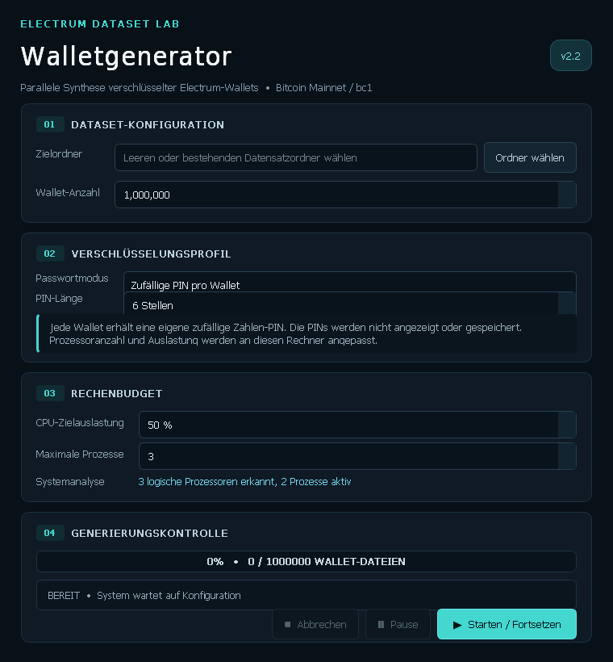

# Walletgenerator

Version 2.2 des Windows-Programms zum Erzeugen verschlüsselter Electrum-Wallet-Dateien mit regulären Bitcoin-`bc1`-Adressen.

## Vorschau

## Windows-Download

[Walletgenerator.exe über Google Drive herunterladen](https://drive.google.com/file/d/12JmmMNM_ns4LL2FxQ26PwXgKrMPIDJXo/view?usp=drivesdk)

SHA-256: `88b28a83097f8a361d4547ed4783004a3e3dd5ef2ff623aca2aaed46f7b5c5c1`

## Verwendung

1. `Walletgenerator.exe` über den obigen Download-Link herunterladen.
2. Einen neuen, leeren Zielordner auswählen.
3. Als Passwortmodus eine zufällige Zahlen-PIN, ein zufälliges Seed-Wort pro Wallet oder ein festes Seed-Wort auswählen.
4. Bei Zufalls-PINs eine Länge zwischen 6 und 20 Stellen einstellen; beim festen Wort ein englisches Seed-Wort auswählen.
5. CPU-Zielauslastung und maximale Prozesszahl passend zum Rechner einstellen.
6. Die gewünschte Anzahl Wallets festlegen und die Erzeugung starten.

Im PIN-Modus erhält jede Wallet eine eigene zufällige PIN. Im Modus für zufällige Seed-Wörter erhält jede Wallet unabhängig ein Wort aus der englischen Seed-Wortliste. Zufällig erzeugte Passwörter werden nicht angezeigt oder gespeichert. Im festen Wortmodus werden alle Wallets mit dem ausgewählten Wort verschlüsselt. Ein abgebrochener Lauf kann im gleichen Zielordner mit identischen Einstellungen fortgesetzt werden.

## Wichtige Eigenschaften

- Electrum-Walletformat auf Basis von Electrum 4.6.2
- reguläre Bitcoin-SegWit-Adressen mit `bc1`
- bis zu 1.000.000 Wallet-Dateien
- wissenschaftlich gestaltete Dark-Mode-Oberfläche mit klar getrennten Arbeitsbereichen
- farbcodierte Zustände für Bereit, Aktiv, Pausiert, Fertig und Fehler
- eigene zufällige Zahlen-PIN pro Wallet mit 6 bis 20 Stellen
- eigenes zufälliges englisches Seed-Wort pro Wallet
- alternativ ein festes Wort aus der englischen Seed-Wortliste
- Schutz vor dem Vermischen von Datensätzen mit unterschiedlichen Passworteinstellungen
- automatische Erkennung der verfügbaren logischen Prozessoren
- einstellbare CPU-Zielauslastung von 1 bis 100 Prozent
- frei begrenzbare Prozesszahl innerhalb der erkannten Rechnerkapazität
- Live-Anzeige der tatsächlich verwendeten Prozesszahl
- reduzierter anfänglicher Adressvorrat, den Electrum beim Öffnen automatisch erweitert
- Pause und Fortsetzen innerhalb eines laufenden Generierungsvorgangs
- Wiederaufnahme vorhandener Datensätze nach einem Abbruch oder Neustart

Die CPU-Zielauslastung wird näherungsweise über die Zahl der Worker-Prozesse begrenzt; sie ist kein exaktes Betriebssystem-Limit. Kurze PINs und einzelne Wörter bieten nur geringen Schutz. Zufällige PINs und Seed-Wörter werden absichtlich nicht gespeichert und können später nicht wiederhergestellt werden. Das Programm eignet sich daher für Testdatensätze. Es sollte kein echtes Bitcoin-Guthaben mit diesen Wallets verwaltet werden.

## Quellcode und Abhängigkeiten

`walletgenerator.py` enthält die Programmoberfläche und Erzeugungslogik. Die veröffentlichte Windows-Datei bündelt Electrum 4.6.2, Python und PyQt6. Hinweise zu eingebundenen Komponenten stehen in `THIRD_PARTY_NOTICES.md`.

